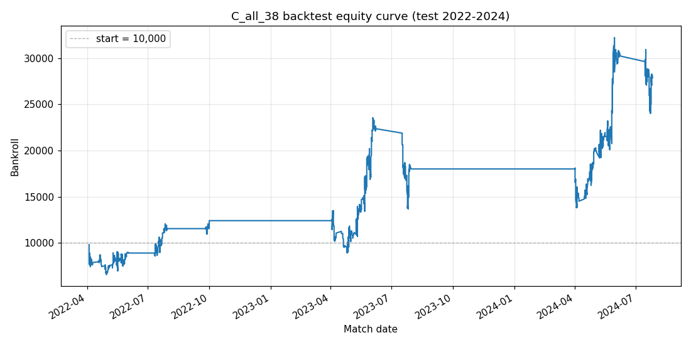

# WTA 红土赛季价值投注:LightGBM 胜率模型 + 等渗校准 + 分数凯利回测

以公开比赛数据预测 WTA 红土场比赛胜负概率,与 Pinnacle 赔率隐含概率比较,在期望值超过阈值时按分数凯利下注,检验模型能否在 2022–2024 测试集上取得扣除抽水后的正收益。

## 结论

- 主模型(C 组,38 个特征)在 2022–2024 测试集上:下注 1288 次,每注收益率 **+4.94%**,夏普 1.235,最大回撤 41.9%(Pinnacle 赔率、1/4 凯利、期望值 > 5%、单注上限 2% 资金)。
- **该收益在统计上不显著。** 对 1288 笔下注重抽样 10,000 次,每注收益率 95% 区间为 [−2.2%, +12.5%],收益率 ≤ 0 的比例约 8.9%;等额下注口径为 +4.80%,区间 [−2.9%, +12.7%]。
- 泄漏审计 5 项全部通过;以同一原始数据从头重跑,净值曲线与审计结果逐字节一致。
- 定位:一个经过泄漏控制、可复现的研究流水线,证据不足以支持"模型能稳定战胜 Pinnacle"。

## 数据

| 来源 | 内容 | 用途 |
|---|---|---|
| [Jeff Sackmann `tennis_wta`](https://github.com/JeffSackmann/tennis_wta) | 1968 年起 WTA 比赛、排名、球员资料 | 比赛结果与特征 |
| [Tennis-Data.co.uk](http://www.tennis-data.co.uk/alldata.php) | 2007–2024 年 WTA 赛果与多家博彩公司赔率 | Pinnacle / Bet365 赔率 |

两份数据通过 `wta_clay/data/name_matcher.py` 按赛事别名表(`config/tournament_alias.csv`)、±7 天窗口、无序球员对与模糊匹配(阈值 85/92)对齐,未匹配样本单独输出供人工复核。

仓库不含数据文件。Sackmann 数据采用 CC BY-NC-SA 4.0 许可,使用时须注明出处且不得商用。

## 方法

**样本划分**(按年份,互不重叠,审计第 5 项检验):

| 集合 | 年份 | 场次 | 用途 |
|---|---|---|---|
| 训练 | 2009–2016 | 5269 | 模型拟合 |
| 校准 | 2017–2018 | 1131 | 只用于拟合等渗校准器 |
| 验证 | 2019–2021 | 1464 | 提前停止 |
| 测试 | 2022–2024 | 1811 | 最终样本外评估,只开封一次 |

**特征**(6 个模块,均只用赛前信息,严格早于比赛日期):红土 Elo(按赛事级别分档 K 值)、近期状态(最近 N 场红土胜率与统治力)、交手记录(贝叶斯平滑)、红土专长(红土胜率 − 全场地胜率)、排名与 8 周排名趋势、疲劳(休息天数、本周场次、赛季累计)。

**四组对照模型**:

| 组 | 特征 | 训练 AUC | 验证 AUC | 测试 AUC | 验证 ROI | 测试 ROI(等额) |
|---|---|---|---|---|---|---|
| A | 仅红土 Elo | 0.757 | 0.711 | 0.759 | +0.64% | +5.02% |
| B | 4 个核心特征 | 0.801 | 0.725 | 0.769 | +2.77% | +9.10% |
| **C** | **全部 38 个** | 0.852 | 0.732 | 0.766 | +3.34% | +4.80% |
| D | 38 个 + 时间衰减 | 0.862 | 0.734 | 0.766 | +3.31% | +6.12% |

C 组为事先指定的主模型(`examples/run_final_decision.py` 文档字符串写定以 C 组测试 ROI 作裁定);其验证—测试收益差距也最小(−1.46 个百分点),且校准检查全部通过(B、D 组校准后 Brier 分数未下降)。按 `wta_clay/models/lgbm.py` 中事先写定的规则,测试 ROI 超过 +5% 视为可疑、须先做过拟合排查,因此其他组的测试读数不作为结论。

**校准**:LightGBM 原始输出平均高估胜率 6–8 个百分点,导致按期望值筛选的等额下注收益为 −4% 至 −7%。在独立的 2017–2018 校准集上拟合等渗回归后应用于验证集与测试集。

**下注**:双方向分别计算期望值 `EV = p × (赔率 − 1) − (1 − p)`,超过阈值时下注;仓位为凯利比例 × 1/4,单注不超过资金的 2%。

## 测试集分解(C 组)

| 维度 | 观察 |
|---|---|
| 赛事级别 | 大满贯 +14.2%、WTA1000 +11.9%;WTA500 −9.4%、WTA250 −0.8% |
| 赔率区间 | 1–5 倍各档为正(+5.0% 至 +18.4%);5–10 倍 −28.5%(141 注)、10 倍以上 −78.6%(61 注) |
| 年份 | 2022 +3.6%、2023 +4.5%、2024 +5.8% |
| 赔率来源 | Pinnacle +4.94%;Bet365 +2.46%;各家最优赔率 +5.66% |
| 期望值阈值 | 3% / 5% / 7% / 10%:+4.84% / +4.94% / +4.18% / +3.97% |
| 凯利比例 | 1/8 / 1/4 / 1/2:+6.76% / +4.94% / +4.25% |



## 泄漏审计

`wta_clay/models/leakage_checks.py`,在生产数据与特征上运行:

1. 严格早于比赛日:近期状态、红土专长、交手记录三个模块各随机抽 30 行,以截至赛前的数据重算,与存档特征逐值一致;排名模块核对所用排名表严格早于比赛日;疲劳模块做取值范围检查;红土 Elo 以构建时的幂等性校验代替逐行重算。
2. 生效日期一致:抽 50 行核对各模块的截止日期均为比赛日期。
3. 六个特征文件由同一份主表快照生成(主表键哈希一致)。
4. 按期望值分桶的命中率单调递减。
5. 四个样本集的比赛编号互不重叠。

## 已知局限

- **对长赔率系统性高估。** 平均期望值 37% 远高于对 Pinnacle 这类高效盘口的合理预期;5 倍以上赔率的 202 注合计亏损约 2.2 万,是模型校准在尾部失效的直接证据。限制赔率上限属于看过测试集后的事后调整,未纳入结论。
- 收益集中在大满贯与 WTA1000,WTA250/500 为负;样本仅 2.3 年、约 1300 注。
- 赔率取自 Tennis-Data 收集的单一时点报价,未考虑可成交性、限额与赔率变动;未做收盘赔率价值(CLV)检验。
- 等渗校准器在 B、D 组上未降低 Brier 分数,说明 2017–2018 与之后年份存在分布差异。

## 运行

```bash
python3 -m venv .venv && .venv/bin/pip install -e ".[dev]"
.venv/bin/python -m pytest tests -q                     # 522 项测试,不需要数据

# 准备数据(见 data/README.md)后:
PYTHONPATH=. .venv/bin/python examples/rebuild_pipeline.py      # 原始数据 → 主表 + 6 个特征文件
PYTHONPATH=. .venv/bin/python examples/run_final_decision.py    # 四组模型、校准、验证/测试对照
PYTHONPATH=. .venv/bin/python examples/run_final_backtest.py    # 主回测、分解、稳健性、泄漏审计、净值图
```

## 目录

```
wta_clay/data       原始数据读取、赔率清洗、球员与赛事匹配、主表构建
wta_clay/features   六个特征模块
wta_clay/models     样本划分、LightGBM、等渗校准、泄漏审计
wta_clay/backtest   资金曲线回测、凯利仓位、绩效统计与分组报告
config/             赛事别名表(Tennis-Data ↔ Sackmann)
examples/           流水线重建、最终裁定、最终回测脚本
tests/              单元与回归测试
```

## 协作声明

研究问题、样本划分、匹配规则、判据与结论由作者设计和确定;代码在 AI 编码助手协助下实现。

## 许可

代码采用 MIT 许可,见 [`LICENSE`](LICENSE)。数据版权归各自来源所有。
